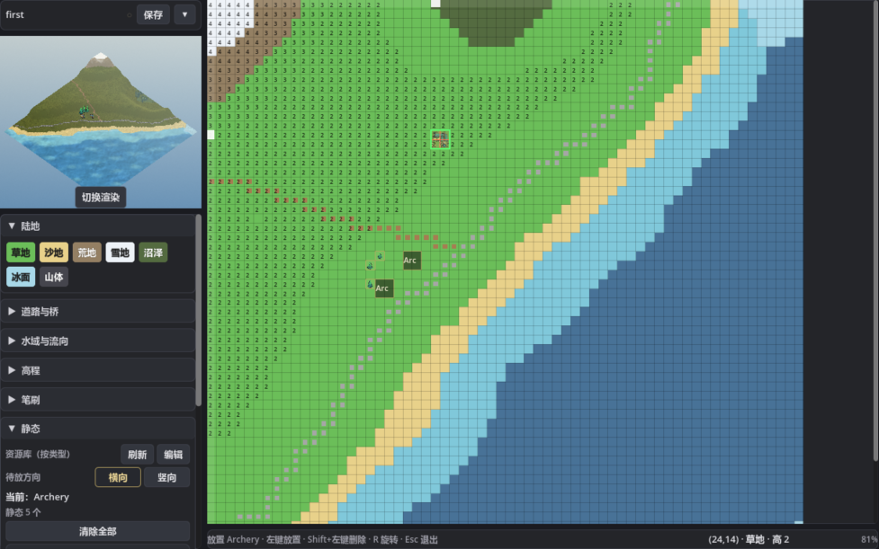
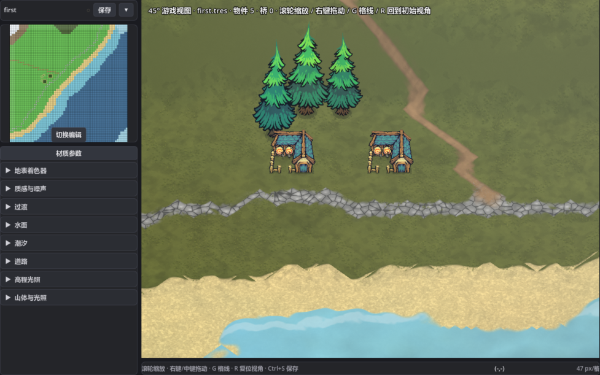
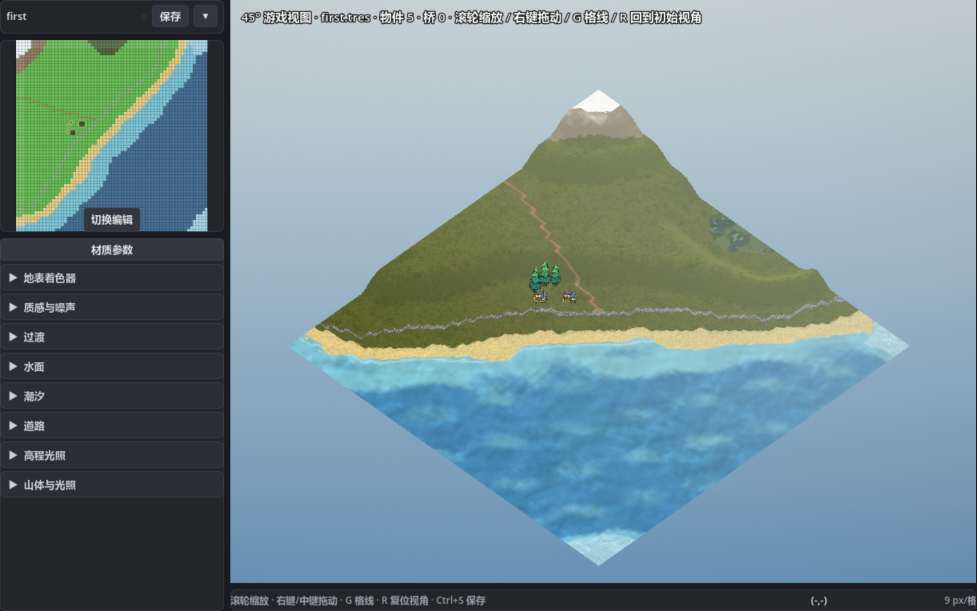

# 游戏端使用示例

这个文件夹演示 **GridAtlas 的产出如何直接用在游戏里**：只吃
`MapData`（`.tres`）+ `RenderSettings`（`.look.tres`），就能拿到外观、玩法和
固定 45° 的游戏视图。编辑器“切换渲染”的大画面也直接复用这里的 `GridAtlas`，
所以工具里看到的 45° 画面就是游戏画面。

## 演示地图 vs. 示例工程

这两个不是一回事：

| 位置 | 是什么 | 说明 |
|---|---|---|
| `maps/first/` | **演示地图数据** | `first.tres` 主图 + `.look / .props / .bridges / .assets / .terrain.gdshader` 边车；编辑器里打开、编辑的就是它 |
| `demos/` | **示例工程** | 演示如何把 `first` 这张地图用在你自己的项目里：加载数据、跑 A*、固定 45° 渲染、遮挡；它不包含地图本身 |

`example.tscn` 和 `grid_atlas_demo.tscn` 都读取 `res://maps/first/first.tres` 及其边车。
换句话说：**`first` 是内容，`demos/` 是消费这份内容的代码和场景。**

## 准备示例素材

截图与 demo 中的建筑、树木、角色来自 Pixel Frog 的
[Tiny Swords (Free Pack)](https://pixelfrog-assets.itch.io/tiny-swords)。
本仓库**不包含**这些原始 PNG；请从 itch.io 免费下载，并把 `Buildings/`、`Nature/`、
`Units/` 放到 `Assets/TinySwords/`。缺少时 demo 会退回程序化占位立牌。

## 效果预览

以下截图都来自编辑器里的 `first` 地图：



*编辑模式：网格、高程、静态资源放置（当前选中 Archery）。*



*渲染模式：固定 45° 游戏视角，和游戏端 `GridAtlas` 是同一套投影。*



*渲染模式整图：同一张地图缩放后的全貌。*

## 三个场景

| 场景 | 用途 |
|---|---|
| `example.tscn` | 俯视 A* 示例：缩放/平移/点击寻路，验证 `MapRuntime` 基础地形寻路（不含物件阻挡，不使用 45° 视图） |
| `grid_atlas_demo.tscn` | **固定 45° 游戏视角**：相机跟随、走格、资源立牌、遮挡规则 |
| `occlusion_test.tscn` | 遮挡验证：合成一道山脊横在角色与相机之间，检查半透明/消失 |

```bash
godot --path . res://demos/example.tscn
godot --path . res://demos/grid_atlas_demo.tscn
godot --path . res://demos/occlusion_test.tscn
```

`grid_atlas_demo.tscn` 操作：WASD 走格（按屏幕方向）｜滚轮缩放｜右键拖动平移｜
G 显示格线（确认地面与实体同一套投影）｜R 回到角色。
截图参数：`--shot [--shot-yaw=135] [--shot-ppm=42] [--shot-cell=32,22] [--shot-debug]`。

## 文件

| 文件 | 作用 |
|---|---|
| `map_runtime.gd` | 运行时核心：数据纹理/高程/噪声/色表/亲和度 → 材质；通行代价与 A* |
| `grid_atlas.gd` / `.tscn` | 45° 地图视图：全屏地表 + 同一投影的实体容器 + 调试图层 |
| `actor_card.gd` | 立牌：程序化占位或贴图，共用脚底锚点/画序/高度场遮挡 |
| `actor_sprite.gdshader` | 贴图立牌着色器（静态资源 / 示例玩家）；遮挡算法与 `actor_card.gdshader` 相同 |
| `actor_card.gdshader` | 程序化占位立牌（贴图缺失时的退路） |
| `debug_grid.gd` | 相机附近逐格画四边形（顶点抬到该格高度），验证投影对齐 |
| `grid_atlas_demo.gd` | 演示场景：取景、相机跟随、走格、缩放、截图 |
| `occlusion_test.gd` | 合成山脊的遮挡验证 |
| `example.gd` / `overlay.gd` | 俯视基础地形寻路示例与覆盖层（只用于验证 `MapRuntime` / A*） |
| `../data/props_data.gd` | 静态资源实例边车；`asset_ids` / `rots` / `cells` / `multipliers` / `visual_offsets` / `size_biases` |
| `../data/static_asset_*.gd` | 静态资源定义/目录/读写：footprint、阻挡掩码、PNG、立牌参数 |
| `../editor/props_tool.*` | 编辑器物件面板（资源库 / 横竖方向 / 植物倍率 / 清空） |
| `../editor/game_preview.*` | 编辑器 45° 视图：渲染模式大画面 + 编辑模式左上角整图概览（复用这里的运行时与立牌） |
| `../Assets/TinySwords/` | 不随仓库分发；从 [itch.io](https://pixelfrog-assets.itch.io/tiny-swords) 下载免费包到该目录，demo 玩家立牌使用 `Units/Warrior_Idle.png` |

> 示例素材：[Tiny Swords (Free Pack)](https://pixelfrog-assets.itch.io/tiny-swords) by Pixel Frog。
> 本仓库不包含原始素材；运行 demo 前请从 itch.io 免费下载并放到 `Assets/TinySwords/`。

## 固定 45° 视角

相机方位固定（`yaw`），不随玩家旋转。默认：

- **相机方位 135°（地图东南）**，看向西北；这是"从地图右下角看中心"的方向
- **俯角 45°**；`pitch`/`yaw` 都是 `GridAtlas` 的属性，改一行就能换。相机固定不旋转，
  预览和游戏都只允许缩放/平移
- **只画可见视口**：地面着色器按屏幕像素步进（开销 ∝ 屏幕大小，与地图大小无关）；
  立牌超出视口由 CanvasItem 自动剔除
- **相机跟随**：中心限制在地图范围内、视口允许伸出图外，角色走到地图边缘也不会离开画面。
  代价是图边之外会露出天空；海面或雾化边界后续再补
- **陡壁不画纹理**：斜角视图里坡度约 >0.12 级/格的坡面不再画俯视结构图案/微凹凸/
  草叶/岩石颗粒，只保留材质底色和光照，避免纹理沿坡拉长；工具小面板的 45° 整图概览同样适用。
  陡面本身是地图的高度台阶（h4→h3→h2）；不想看到陡面就降低 look.height_scale 或把高度改缓
- **游戏视图不画地图边缘的假切面**：图外直接露天空；工具小面板的 45° 整图概览与游戏视图一致，
  也不画切面

投影公式（着色器与 GDScript 完全一致）：

```
fd = (-sin yaw, cos yaw)        视线方向（相机 → 场景）
rt = (-fd.y, fd.x)              屏幕右向
screen = 视口中心 + ppm · ( (P-C)·rt , (P-C)·(-fd)·sin(pitch) - z·cos(pitch) )
```

`GridAtlas` 里 `cell_to_screen / screen_to_cell / projected_point` 是同一组公式；
实体的脚底、点击拾取、调试格线都走它，所以不会出现"地面在动、树在滑"。

## 遮挡规则（按实体类别区分）

立牌着色器（贴图走 `actor_sprite.gdshader`，无贴图退回 `actor_card.gdshader`）从脚底格
出发，沿"朝相机"的水平方向采样平滑高程场：该处地表高于视线
（`立牌高度 + 水平距离·tan(pitch)`）时判为被挡。

| 实体 | `u_fade` | 被山挡住时 |
|---|---|---|
| 角色 | 0.38 | 半透明，玩家始终能看见自己 |
| 树/建筑等静态物体 | 0.0 | 完全消失；高的树只可能露出树梢 |

判定是**逐片元**的：同一棵树的下半截可以被挡掉、树冠还露在脊线外，而不是整块
贴图一起淡出。`occlusion_test.tscn` 就是验证这个的。

## 物件（开发期放置）

工具左侧面板滚到“物件”：

- **资源库**来自 `Assets/static_assets/catalog.tres`，按类型分成建筑 / 树木 / 道具 / 门 / 栅栏 / 其他小节，每个已导入的资源一个按钮；
  点右侧「编辑」弹出资源导入页，保存/删除后关闭，主编辑器会自动重读 catalog（也可点“刷新”）。
- **方向**：资源库上方的「横向 / 竖向」两个按钮控制下一次放置。竖向会交换占地范围
  （3×1 门变成 1×3），阻挡掩码跟着转，45° 立牌贴图水平镜像（左右 `art_lift` 也换边）。
  鼠标悬停在已放资源上按 **R** 在横/竖之间切换；鼠标不在资源上按 R 只切换待放置方向。
  越界/与其它实例重叠会拒绝切换，切换进入撤销/重做。
- **左键放置，右键按占地范围删除**。落点框绿色 = 可放；红色 = 越界 / 与已有实例的
  占地范围重叠。
- **植物倍率**：选中 `category=tree` 的树/竹子后出现「植物倍率 1×~4×」。占地/阻挡按整数倍
  （1×1 → 2×2 → 3×3 → 4×4），图片按 1/1.5/2/2.5 倍渐变，避免 1× 到 2× 之间断层；倍率只对植物生效。
- **植物视觉偏置**：每次放置植物会随机写入 ±0.055×倍率 格的位置偏移和 0.92~1.08 的尺寸
  偏置；只影响 45° 图片、俯视图标和树根草垫，不改变占格/阻挡。
- **植物个体差异**：同一资源每株按资产 id + 格子坐标派生稳定差异（叶色调、整体大小
  0.88~1.12、宽高比、树冠形变、约 1/3 镜像），不写存档；旧地图里的树也会自动变得不完全一样。
- 静态资源按定义里的 `footprint` 占地、按 `blocking_cells` 阻挡 A*（例如 3×1 院门只有两端
  门柱挡路，中间门洞可通行），落点预览会直接用红/绿格标出；植物倍率会同步放大这两者。
- 资源落点以鼠标格为中心（奇数边长正好居中；2×2 时鼠标格是左上角）；放置不受地形限制，
  桥/建筑可以直接放在水面上，同一片占地范围不能叠放。
- **保存地图时同时写 `<地图名>.props.tres`**（例：`first.tres → first.props.tres`）。
  撤销/重做、改尺寸时裁掉越界物件，都包含物件层（含 `asset_ids` / `rots` / `multipliers` /
  `visual_offsets` / `size_biases`）。

运行 `grid_atlas_demo.tscn` 会自动加载同名边车：按实例数据生成立牌，并把实际阻挡格写进 A*。
静态资源实例会读取同一份资源定义，贴图按 `content_rect` 裁切，立牌大小/侧向拉伸/图片偏移
（`art_size` / `art_lift` / `art_offset`）与导入页看到的一致；立牌脚底用**旋转后占地范围**的中心，
竖向资源会把贴图水平镜像（左右 `art_lift` 换边），但仍是正面朝向相机。
建筑等需要贴地的资源用**左右侧拉伸**：`art_lift`（左/右整侧抬升比例）+ `art_size` / `art_offset`
手动调；它只能让底边贴着一条斜线，不能同时精确命中占地的左/前/右三个角，前面那个角可能需要
`art_offset` 微调。
没有边车时显示空地图（不再生成随机林）。

在编辑器里放完物件**不必先保存**，直接切“渲染模式”就能在大画面里看到 45° 立牌；
保存是为了把物件写进 `.props.tres`，让游戏和 demo 也能读到。

## 桥（独立桥层）

桥不在静态资源库里，也不是贴图立牌，而是独立的 `BridgesData` 边车（`data/bridges_data.gd`）。

- 编辑器“道路”面板下方有 **独木桥 / 木桥 / 石桥** 三个按钮。
- 选中后左键拖两个陆地格作为 **1×1 桥座**：两座之间的整段水面自动成为桥身，长度不限；斜拖会按主导轴吸附，**不能拐弯**。桥座/桥身任一格不合法都会拒绝。
- 右键删除鼠标下的桥；桥在俯视图里是一条 1 格宽的带子，45° 视图由 `runtime/procedural_bridge.gd` 现场生成。
- 桥数据保存在与地图同名的 `<地图名>.bridges.tres`；A* 把桥线格子覆盖为 `surface_cost=0.6`。
- 游戏 demo 用 `MapRuntime.surface_z()` 放角色，角色会真正站在桥面上；编辑器 45° 预览不建 A*。

编辑器已移除内置物件按钮和立牌缩放滑条：新物件全部来自资源库。内置物件的运行路径也已
完全移除——旧边车（`kinds/cells/scales` 格式）里的实例在载入时丢弃，不再渲染/阻挡。示例场景的
玩家立牌仍使用 `Assets/TinySwords/` 的战士贴图（`demos/demo_unit.gd`），它不是可放置的地图资源；该目录需要自行从 itch.io 下载。


## 接进自己的游戏

地图数据按地图分文件夹：`maps/<地图名>/<地图名>.tres`，同目录放
`<地图名>.props.tres` / `.look.tres` / `.bridges.tres` / `.assets.tres` 边车；边车路径由 `get_basename()` 推导，移动地图时整套一起移动即可。`.assets.tres` 只服务编辑器的「本图热点」快捷区，运行时不读。

```gdscript
const RUNTIME_SCRIPT = preload("res://runtime/map_runtime.gd")

var rt = RUNTIME_SCRIPT.new()
rt.setup(load("res://maps/first/first.tres"), load("res://maps/first/first.look.tres"))
$GridAtlas.setup(rt)                     # 地表 + 实体容器就位
$GridAtlas.set_center_cell(Vector2(32.5, 32.5))
$GridAtlas.set_zoom(42.0)

rt.is_walkable(cell)                     # 可通行
rt.move_cost(cell)                       # 移动代价（越小越快，0 = 不可通行）
rt.height_at(cell)                       # 高程（级）
rt.water_at(cell)                        # 水域类型
rt.find_path(from_cell, to_cell)         # A* 路径（格子序列）
rt.path_cost(path)                       # 路径总代价
rt.smooth_level(cell) / rt.terrain_z(cell)  # 渲染高度（与着色器同一张场）

# 静态资源定义（物件边车里只会有静态资源实例）
var asset_defs = {}
for def in StaticAssetStore.load_all(StaticAssetStore.load_catalog()):
	asset_defs[def.id] = def

# 物件（可选）：与地图同名的 <map>.props.tres，保存过物件后才会生成
var props = load("res://maps/level_1_content/level_1_content.props.tres")
props.set_asset_defs(asset_defs)         # 定义里查 footprint/阻挡格
rt.apply_props(props)                    # 按资源定义只写实际 blocking_cells
```

约定：`cell_to_screen` / `screen_to_cell` 用的是**格坐标**（0..map_size，格心在
x+0.5），不是世界像素。`MapRuntime.CELL_SIZE`（16）只服务于旧的俯视示例。

物件数据是并行数组：`asset_ids / rots / cells(交错 x,y) / multipliers /
visual_offsets / size_biases`，读取用
`props.asset_id_at(i) / props.rotation_at(i) / props.cell_at(i) /
props.multiplier_at(i) / props.visual_offset_at(i) / props.size_bias_at(i)`。
旧边车如果只有 `kinds/cells/scales`、没有 `asset_ids`，载入时 `sanitize()` 会整体清空；
`asset_ids[i]`、`rots[i]`、`cells[2i]` 才是有效数据。占地/阻挡格从
`Assets/static_assets/defs/<id>.tres` 解析（实例不重复存档）。
**地图和物件是两个文件**，拷贝地图时记得带上 `.props.tres`。

示例场景的玩家立牌仍使用 `Assets/TinySwords/Units/Warrior_Idle.png`，由
`demos/demo_unit.gd` 在内存里裁切；该素材不随仓库分发，请从
[Tiny Swords (Free Pack)](https://pixelfrog-assets.itch.io/tiny-swords) 下载到 `Assets/TinySwords/`。

新的静态资源来自 `Assets/static_assets/defs/*.tres` + `Assets/ChineseVillage/
Processed/delivery/<族>/`（最终交付件按分类分中文文件夹、中文命名）；导入与占地范围
定义流程见 `Docs/三期-资源导入.md`。

## 性能取舍

地表是直接把着色器铺在全屏 `ColorRect` 上（每帧按屏幕像素算）。这最省事、
缩放最锐利，开销按可视像素走，和地图尺寸无关。GTX 1050 / GL Compatibility
实测（`--bench`，含约 100 个立牌的遮挡采样）：

- 1280×720：**4.4 ms/帧**（228 fps）
- 1920×1080：**9.4 ms/帧**（107 fps）

默认 `project.godot` 设了 `application/run/max_fps=60`，避免编辑器里的 45° 预览
把 GPU 一直跑满、风扇狂转；`--bench` 会临时关闭这个上限来测理论帧率。
接触阴影现在是一张共享径向渐变纹理、每个立牌一次 `draw_texture_rect`，
不再每个立牌画 12 层圆。

地图更大或 GPU 更弱时：

1. **渲染到 SubViewport**（按世界分辨率渲一次，地图/外观/相机变化时才重渲），
   游戏里只贴一张纹理；水面动效单独叠一层。
2. **缩放 LOD**：远景关掉草叶、碎石、浮雕高频（按 `ppm` 传 uniform 开关）。

## 已知取舍

- **立牌不压缩**：2.5D 里常见做法，树/人保持竖直比例。遮挡换算时按
  `实际世界高度 = 美术高度 / cos(pitch)` 处理；要严格按 3D 高度压扁立牌，
  把 `u_art_height` 改成 `美术高度` 并同步压缩立牌尺寸即可。
- 渲染的岸线/道路边界是连续场与圆角，玩法边界是整格——**玩法以整格为准**。
- 默认代价：草 1.0、沙 1.15、荒地 1.3、雪 1.4、沼泽 2.0、冰 0.8；
  道路 0.5~0.75；浅水 3.0；深水不可通行；每高一级 +3%。
  都在 `map_runtime.gd` 顶部，按游戏需要改。
- 地块高度是**视觉数据**：`look.height_scale` 默认 2.5 格/级，适合展示地形，
  但一步 2.5 格高的"台阶"在玩法上是否可走，需要在移动规则里单独决定。
- 物件与地图分文件保存：拷贝/移动地图时把同名的 `.props.tres` 一起带上。
- 静态资源立牌目前固定第 0 帧；示例玩家也只取 `Warrior_Idle` 的第 0 帧，动画还没接。
- 只接入了示例所需的蓝队战士；其他队伍色、UI、特效、资源点和 terrain tileset 未使用。
  素材来自 [Tiny Swords (Free Pack)](https://pixelfrog-assets.itch.io/tiny-swords)，不随仓库分发。
- 编辑模式左上角是 45° 整图概览（有立牌、只读）；渲染模式左上角是俯视网格镜像。
  45° 立牌和遮挡看这个概览、渲染模式大画面或 `grid_atlas_demo.tscn`。
- 立牌按占地中心格取一个地表高度：跨坡的房子/树可能有一侧悬空，后续可做
  多脚采样或“占地压平”。
